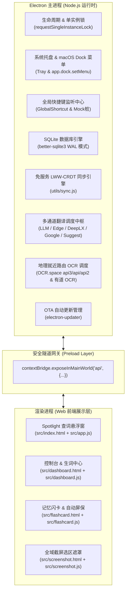
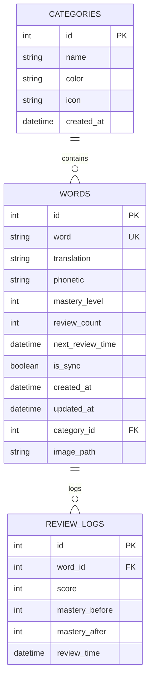
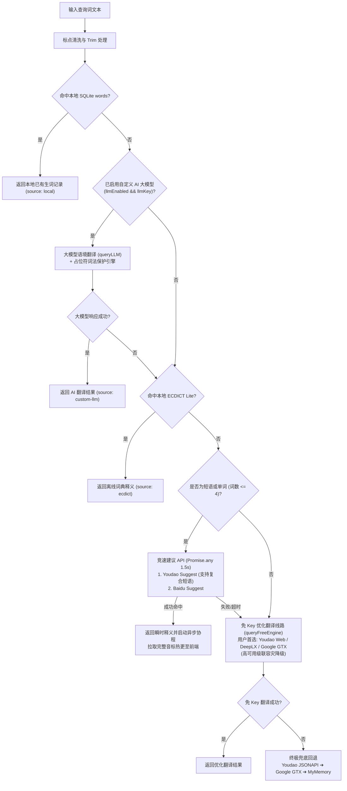

# 识光 Lumina - 系统全景技术架构设计 (System Architecture Document)

**版本适用**: V1.9.1+  
**最后修订**: 2026年  
**定位**: 桌面极客级英语生词管理与闪卡记忆法系统，具备离线本地优先、高精度分级翻译、全域截图OCR与免服务无感同步能力。

---

## 一、 系统全景与多进程模型 (Process Architecture)

识光 Lumina 采用成熟的 **Electron 主进程 + ContextBridge 网关 + 渲染进程隔离** 架构，严格遵循最小特权原则，渲染层禁用 `nodeIntegration`。



---

## 二、 数据持久化与免服务同步架构 (Storage & Sync)

### 1. 数据库模式设计 (`utils/db.js`)
- **存储路径**: 位于操作系统标准应用数据目录 `app.getPath('userData')/main.sqlite`。
- **并发控制**: 强制执行预写日志模式 `PRAGMA journal_mode = WAL;`，配合外键约束 `PRAGMA foreign_keys = ON;`，消灭高频查词与后台读写并发时的锁死冲突。
- **核心数据表关系**:



### 2. 免服务网盘 LWW-CRDT 同步机制 (`utils/sync.js`)
为彻底免除自建中央服务器的停服风险与月租负担，系统首创了基于本地网盘的无代理同步方案：
1. **配置存储**: `userData/sync_config.json` 记录用户选定的本地网盘挂载路径（如 OneDrive、Dropbox、iCloud）。
2. **格式标准化**: 将 SQLite 数据以单词为唯一 Key 扁平化导出为 `dict_sync_data.json`：
   ```json
   {
     "artificial": {
       "word": "artificial",
       "translation": "adj. 人造的，仿造的",
       "phonetic": "ɑːtɪˈfɪʃl",
       "mastery_level": 3,
       "review_count": 4,
       "next_review_time": "2026-10-02T10:00:00.000Z",
       "updated_at": "2026-10-01T15:20:00.000Z"
     }
   }
   ```
3. **冲突消解 (Last-Write-Wins)**:
   - 读取同步文件时，以 `updated_at` 时间戳为判定依据。
   - 当 `remoteTime > localTime` 时执行 `ON CONFLICT(word) DO UPDATE` 覆写更新；当本地不存在该词时插入新记录。
   - 同步完成后即刻反向将合并后的最新状态写回 `dict_sync_data.json`。
4. **生命周期触发**:
   - 用户在设置面板选择文件夹时立即执行双向同步并初次导出。
   - 用户点击“立即强制同步 (Force Sync)”时主动触发。
   - 应用退出时触发全量基准快照转储。

---

## 三、 多层级级联查词与翻译流水线 (Translation Pipeline)

为兼顾“毫秒级响应”与“长难句专业语境”，主进程在 `search-word` 管道中实现了多级智能路由：



---

## 四、 词法保护与专业术语直译引擎 (`utils/preservation.js`)

在面对代码段落、富文本及中英混杂语句时，传统翻译引擎极易破坏代码语法并将专业词汇译为不知所云的中文。Lumina 在前置词法分析阶段进行了源头级解耦：

### 1. 占位符隔离算法
1. **多重特征正则匹配**:
   - Inline 代码块：`` `[^`\n]+` ``
   - HTML/XML 标签：`<[^>]+>`
   - 单行与多行注释：`//...` 与 `/*...*/`
   - 编程语言关键字及语句行
   - 函数调用语法：`foo(bar)`
   - 驼峰与下划线变量：`camelCase`, `snake_case`
   - 专业术语表：动态编译 `glossary.json` 中所有键生成的单词边界正则 `\bterm\b`
   - 已存中文字符串：`[\u4e00-\u9fa5]+`
2. **非重叠区间过滤 (Non-overlapping Intervals)**:
   - 提取所有匹配项后，按起始位置由前至后、长度从长至短排序。
   - 严格滤除重叠区间，避免嵌套覆盖导致语法崩塌。
3. **占位符编码**:
   - 按照顺序替换为 `[__CODE_0__]`, `[__CODE_1__]`, ...
4. **语序无损回填与术语置换**:
   - 翻译引擎处理纯英文骨架。
   - 翻译返回后，将 `[__CODE_N__]` 原位还原为对应原代码、中文或在 `glossary.json` 中配置的精准译名（如 `Auto-Pop` ➔ `自动弹出`）。

---

## 五、 全域截图翻译、本地保存与图文资产沉淀 (Screenshot, OCR & Visual Asset)

### 1. 截图与权限守卫 (Permission Gatekeeper)
1. 用户触发快捷键 `CommandOrControl+Shift+X`（或点击查词框截图按钮）。
2. 主进程在 macOS 下主动执行 `systemPreferences.getMediaAccessStatus('screen')` 检查权限。若被系统拒绝或未授权，弹出友好指引弹窗，并提供「打开系统设置」按钮一键跳转 `x-apple.systempreferences:com.apple.preference.security?Privacy_ScreenCapture`，坚决杜绝静默失败。
3. 权限完备后，主进程检测光标所在显示器，利用 `desktopCapturer.getSources({ types: ['screen'] })` 高清抓取对应屏幕画面。
4. 全屏置顶 `screenshotWindow`，挂载 `screenshot.html`。
5. 前端 Canvas 根据设备像素比 (DPR) 绘制暗色半透明遮罩与裁剪亮区。选区具备专业级交互能力：
   - **8 向微调锚点与拖拽平移**：生成选区后自动呈现 4 角 + 4 边缘共 8 个控制把手（`nw/n/ne/e/se/s/sw/w`），光标自适应切换调整指针；按住选区内部可直接整体移动选区；
   - 选区成型后自动弹出赛博毛玻璃浮动工具条（Action Toolbar），集成 5 大核心功能：
     - **✔ 翻译** (`Enter`)：提取文字并启动 Spotlight 搜索与释义；
     - **📝 提取文字** (`T`)：执行 OCR 解析并弹出「文字识别对照结果 (Recognition Comparison)」浮层（左侧原图选区、右侧可编辑校对文本、字符数与图片尺寸元数据），集成一键「📋 复制文字」（带高亮反馈）、「🔍 查词翻译」与「💾 保存图片」，文字亦同步自动写入剪贴板；
     - **📋 复制图片** (`Cmd/Ctrl+C`)：通过 `clipboard.writeImage` 秒级将截屏图片写入剪贴板；
     - **💾 保存图片** (`Cmd/Ctrl+S`)：调起系统级 `dialog.showSaveDialog` 保存为本地 PNG 文件（自动降维处理顶层全屏遮挡，确保系统文件选择框 100% 呈现在前台）；
     - **✖ 取消** (`Esc`)：关闭截图。

### 2. 本地图片与剪贴板图文提取多维链路 (Multi-Source Image OCR)
1. **Spotlight 聚合面板直提**:
   - 搜索栏右侧新增「打开本地图片提取文字」按钮，支持选取 `.png`, `.jpg`, `.jpeg`, `.webp`, `.bmp` 等图片；
   - 支持直接向 Spotlight 窗体拖拽本地图片文件；
   - 支持在查词面板中直接按 `Cmd+V` 粘贴剪贴板中的图片，自动触发 OCR 提取并填充输入框。
2. **Dashboard 独立图片文字提取工作台 (OCR Workbench)**:
   - 侧边栏专属导航页：提供现代化双栏工作台，支持点击上传、拖拽放入及全局 `Cmd+V` 粘贴；
   - 多语种切换（中/英/日/韩/法/德/西/俄等）；
   - 左右分屏对比：左侧自适应图片高清预览与尺寸元数据，右侧多行实时文本编辑器；
   - 生产力工具链：字符/单词数实时统计、一键复制全部文本、一键智能翻译与一键导出为 `.txt` 文本文件。

### 3. 多层高可用 OCR 引擎路由架构 (Multi-Tier High-Availability OCR Architecture)
- **Apple Vision 原生离线引擎 (macOS 首选，零延迟免 Key)**:
  - 在 macOS 环境下默认优先调用编译为独立可执行文件的原生 Swift 工具 [`resources/mac_ocr`](file:///Users/mon3xey/projects/dict-app/resources/mac_ocr)。
  - 基于 macOS 底层 `VNRecognizeTextRequest`（准确模式 `.accurate`），100% 本地离线执行，耗时仅 10~20ms，免去网络依赖与 API Key 配置。
  - 原生支持简体中文 (`zh-Hans`)、繁体中文 (`zh-Hant`)、英文 (`en-US`) 及日文 (`ja-JP`) 混合识别，中文排版与分词准确率极高，彻底告别字符乱码。
- **OCR.space 神经网络云端引擎 (智能降级 / Windows & Linux 默认)**:
  - 接入 OCR.space 官方节点，并开启神经网络 `OCREngine: '2'` 与自动方向识别。
  - 彻底淘汰旧版 Tesseract 1 引擎在非英文模式下的笔画误判；当遇到中文或混合语言时，使用神经网络引擎自动识别中英文，避免把中文文字误判为 ASCII/标点噪点乱码。
  - 单节点超时压缩为 **4 秒快速熔断**，若遇网络抖动立即自动切换备用节点 (`api2.ocr.space`)。
- **有道智云 OCR 商业级支持**:
  - 支持配置 AppKey 与 AppSecret，基于 SHA-256 HMAC 计算动态签名 (`sign = sha256(appKey + base64 + salt + curtime + secretKey)`)，提供极高中文与代码识别准确率。

### 4. 生词图文资产沉淀与 Lightbox 语境复盘
- **自动化图片本地落盘**:
  - 当截图查词并点击“加入生词本”时，主进程将图片持久化到 `userData/screenshots/<word>_<timestamp>.png`。
  - SQLite `words` 表新增 `image_path` 字段，热迁移自动兼容历史数据库，实现单词与截图快照的强绑定。
- **Spotlight & Dashboard 双端 Lightbox 联动**:
  - Spotlight 面板展示截图缩略图，提供一键复制、一键另存与点击全屏放大，并配备一键复制识别文字按钮。
  - Dashboard 控制台在生词列表中为图文生词标注 `📷` 徽章，点击在毛玻璃全屏 Lightbox 弹窗中载入当时截屏快照，并支持一键复制到剪贴板与另存为。
  - Dashboard 控制台在生词列表中为图文生词标注 `📷` 徽章，点击在毛玻璃全屏 Lightbox 弹窗中载入当时截屏快照，并支持一键复制到剪贴板与另存为。

---

## 六、 艾宾浩斯双轨复习引擎 (Spaced Repetition System)

### 1. 算法核心 (`utils/sm2.js`)
掌握度等级划分为 0~5 六级：
- **打分 1 (Forgot)**: 掌握度重置为 `0`，5 分钟后再次复习。
- **打分 2 (Hard)**: 掌握度减 1 (下限 0)。
- **打分 3 (Good)**: 掌握度加 1 (上限 5)。
- **打分 4 (Easy)**: 掌握度加 2 (上限 5)。

时间偏移阶梯映射：
$$\text{Interval} = \{0: 5\text{m},\, 1: 60\text{m},\, 2: 720\text{m},\, 3: 1440\text{m},\, 4: 4320\text{m},\, 5: 10080\text{m}\}$$

### 2. 双轨交互形态
- **沉浸屏保模式 (Auto Slideshow)**:
  - 隐去一切打分按钮，悬浮于右下角。
  - 自动节奏：单词展示 2s ➔ 自动翻转展示释义 3s ➔ 自动触发 `slideshow-next` 拉取下一个待复习单词。
- **碎片时间复习 (Shuffle Play)**:
  - 随时调取到期生词队列。
  - 极客键盘流：`Space` 或 `Enter` 快速翻转正面/背面；左手区逆向指位 `4` (Forgot)、`3` (Hard)、`2` (Good)、`1` (Easy) 盲操打分。
  - 边缘微缩泡泡：支持拖动至屏幕左/右边缘自动停靠为半透明小圆球，点击瞬间还原。

---

## 七、 全局 IPC 通道字典 (IPC Catalog)

| IPC 频道名称 | 类型 | 方向 | 功能描述 |
|---|---|---|---|
| `search-word` | `handle` | R ➔ M | 核心查词：执行级联解析并返回结果与来源标识 |
| `save-word` | `handle` | R ➔ M | 保存单词至 SQLite `words` 表 (含图文关联 `image_path`) |
| `delete-word` | `handle` | R ➔ M | 删除指定 ID 单词及其 `review_logs` 级联日志 |
| `get-all-words` | `handle` | R ➔ M | 获取生词本全量词汇列表 |
| `get-word-image` | `handle` | R ➔ M | 读取指定本地截图快照并返回 Base64 供 Lightbox 原图大图展示 |
| `get-analytics` | `handle` | R ➔ M | 聚合计算 365 天热力图、7 日压力与掌握度分布 |
| `get-sync-config` | `handle` | R ➔ M | 获取免服务网盘同步当前配置及同步状态 |
| `select-sync-folder` | `handle` | R ➔ M | 打开系统目录选择框选择网盘同步路径 |
| `set-sync-folder` | `handle` | R ➔ M | 设定同步目录并即刻执行初次双向导出同步 |
| `force-sync` | `handle` | R ➔ M | 立即执行本地与网盘 JSON 差异比对合并 |
| `set-shortcut` | `handle` | R ➔ M | 实时动态设置 Spotlight 查词全局快捷键并检测冲突 |
| `set-screenshot-config` | `handle` | R ➔ M | 配置截图快捷键、OCR 引擎与秘钥 |
| `set-free-engine-config` | `handle` | R ➔ M | 设置免 Key 优化翻译线路 (Edge/DeepLX/Google) |
| `set-llm-config` | `handle` | R ➔ M | 设置自定义 AI 大模型参数 (Provider, URL, Key, Model) |
| `test-llm-connection` | `handle` | R ➔ M | 测试 AI 大模型 API 连通性 |
| `trigger-screenshot` | `send` | R ➔ M | 主动触发全屏屏幕捕获与 8 向裁剪遮罩 |
| `get-screenshot-image` | `handle` | R ➔ M | 截屏窗口获取当前捕获的桌面全屏图像 |
| `complete-screenshot` | `handle` | R ➔ M | 提交裁剪图片 Base64 执行 OCR 解析并推送到查词窗口 |
| `save-screenshot-image` | `handle` | R ➔ M | 调起原生系统保存对话框将裁剪图片实打实写入磁盘为 PNG 文件 |
| `copy-screenshot-image` | `handle` | R ➔ M | 将裁剪截图转换为 NativeImage 秒级写入系统剪贴板 |
| `extract-text-from-image` | `handle` | R ➔ M | 核心图片提取：优先 Apple Vision 离线引擎提取文字并可选自动拷入剪贴板 |
| `open-image-ocr-dialog` | `handle` | R ➔ M | 调起原生系统文件选择器，选取图片并执行 OCR 提取 |
| `save-text-file` | `handle` | R ➔ M | 调起系统保存框将提取的纯文本导出为 .txt/.md 文件 |
| `copy-text-to-clipboard` | `handle` | R ➔ M | 将纯文本内容直接写入系统剪贴板 |
| `close-screenshot` | `send` | R ➔ M | 关闭截屏窗口并恢复查词主窗口焦点 |
| `get-theme` / `set-theme` | `handle` | R ➔ M | 获取与设定变色龙光影引擎主题模式 (light/dark/system) |
| `get-autostart` / `set-autostart` | `handle` | R ➔ M | 获取与设定开机静默自启动 |
| `get-autopopup` / `set-autopopup` | `handle` | R ➔ M | 获取与设定剪贴板变化自动唤出查词 |
| `get-autoreview` / `set-autoreview` | `handle` | R ➔ M | 获取与设定艾宾浩斯防打扰纯净拦截模式 |
| `get-version` | `handle` | R ➔ M | 获取当前应用版本号 (1.9.1) |
| `submit-review` | `send` | R ➔ M | 提交卡片复习打分，驱动 SM-2 算法流转 |
| `start-shuffle-play` | `send` | R ➔ M | 启动碎片时间即时复习队列 |
| `start-auto-slideshow` | `send` | R ➔ M | 启动全自动被动屏保轮播 |
| `slideshow-next` | `send` | R ➔ M | 屏保轮播拉取下一条到期词汇 |
| `check-update` | `handle` | R ➔ M | 检查 GitHub Releases 是否有新版本 |
| `download-update` | `handle` | R ➔ M | 下载 OTA 更新包 |
| `install-update` | `handle` | R ➔ M | 安装更新包并退出重启 |
| `update-message` | `event` | M ➔ R | 推送版本更新状态与下载百分比进度 |
| `screenshot-ocr-start` | `event` | M ➔ R | 通知查词面板进入 OCR 提取等待态 |
| `screenshot-ocr-success` | `event` | M ➔ R | 推送 OCR 识别文字及对应缩略图 |
| `update-phonetics` | `event` | M ➔ R | 异步推送后台获取的完整音标数据 |
| `dock-state-changed` | `event` | M ➔ R | 通知卡片窗体边缘停靠状态改变 |
