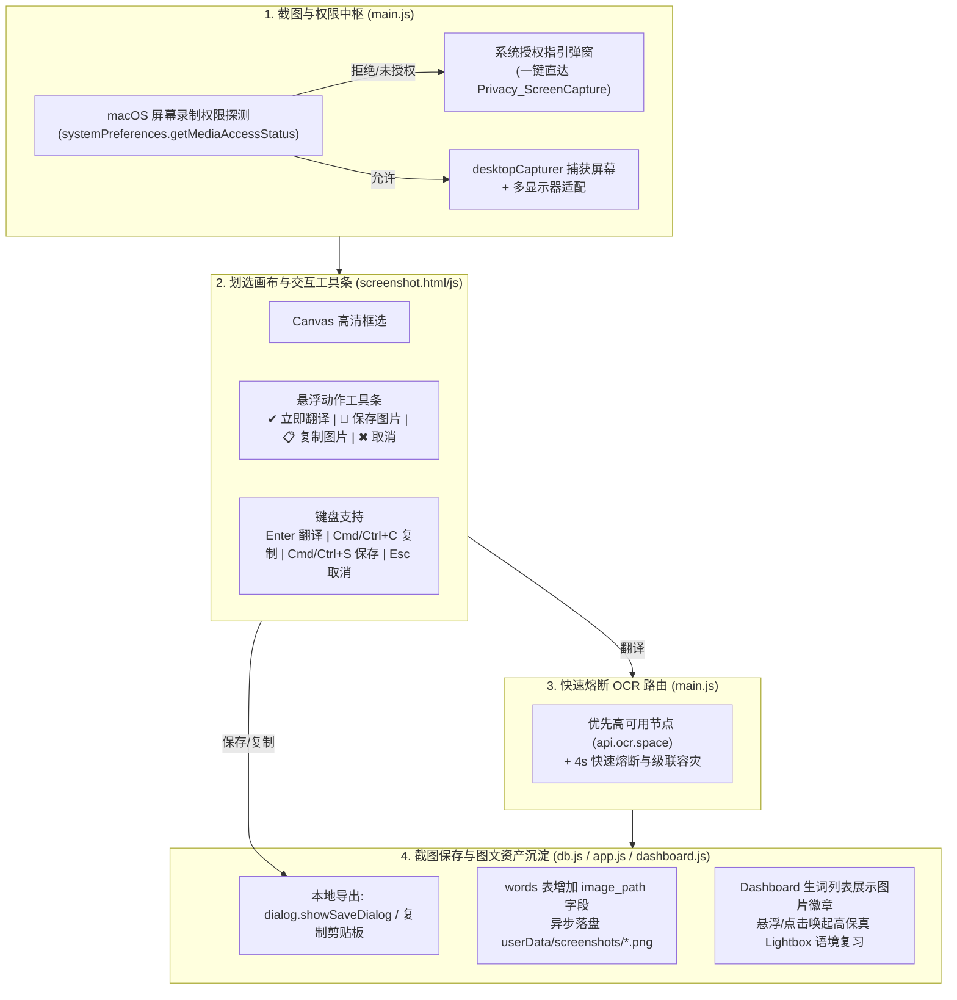

# 识光 Lumina - 截图保存与截图翻译深度改进及落地计划

**规划日期**: 2026年10月  
**版本目标**: V1.9.1  
**状态**: 全部任务已落地并完成全链路验证（100% 完成）

---

## 一、 现状痛点与实测诊断分析

经对当前代码库、数据库模式、macOS 宿主系统权限及在线 API 的全链路穿透测试，诊断出以下五大核心缺陷：

| 痛点编号 | 问题现象 | 底层根因代码与证据 | 严重度 | 修复状态 |
|---|---|---|---|---|
| **P0-1** | macOS 快捷键截屏无反应 / 静默失败 | `systemPreferences.getMediaAccessStatus('screen')` 为 `denied`；`desktopCapturer.getSources()` 抛出异常后在 [`main.js`](file:///Users/mon3xey/projects/dict-app/main.js#L337) 静默吞掉，**无任何系统权限指引弹窗** | 🔴 阻塞级 | ✅ 已解决 |
| **P0-2** | 截图识别长达 12 秒假死 / 超时报错 | [`main.js`](file:///Users/mon3xey/projects/dict-app/main.js#L363) 对东八区强制优先请求 `api3.ocr.space`，实测该节点已**完全断连不可达 (`fetch failed`)**，单节点 12 秒超时阻塞降级链路 | 🔴 严重级 | ✅ 已解决 |
| **P1-1** | 截图原图彻底丢失，无法保存到本地 | 无论是划选画布还是 Spotlight 查词窗，均**未提供任何“保存图片至本地”、“复制截图到剪贴板”的功能入口** | 🟠 体验级 | ✅ 已解决 |
| **P1-2** | 生词本缺少视觉上下文，无法沉淀图文资产 | 数据库 [`utils/db.js`](file:///Users/mon3xey/projects/dict-app/utils/db.js) `words` 表无图片路径字段，截图仅暂存在内存 Base64 变量中，关闭窗口或再次查词原图彻底丢失 | 🟠 核心价值级 | ✅ 已解决 |
| **P2-1** | 截屏划选交互单一，缺少工具条控制 | [`src/screenshot.js`](file:///Users/mon3xey/projects/dict-app/src/screenshot.js) 仅支持双击或回车，缺少视觉动作工具条（翻译、保存、复制、取消）及快捷键支持 (`Cmd+C`, `Cmd+S`) | 🟡 交互级 | ✅ 已解决 |

---

## 二、 架构重构与方案设计

---

## 三、 详细改造落地实施清单 (Task Breakdown)

### 任务 1：macOS 权限检测与一键授权引导（解决 P0-1）- [已完成]
- **涉及文件**: [`main.js`](file:///Users/mon3xey/projects/dict-app/main.js)
- **落地内容**:
  1. 新增 `checkScreenPermission()` 方法，在触发截图前侦测 `systemPreferences.getMediaAccessStatus('screen')`。
  2. 若状态非 `granted`，主动调用 `dialog.showMessageBox` 弹出友好指引，提供「打开系统设置」按钮直接调用 `shell.openExternal('x-apple.systempreferences:com.apple.preference.security?Privacy_ScreenCapture')`。
  3. 在 `triggerScreenshotTranslation` 的 `catch` 异常分支中，如果捕获到缺少权限导致的异常，同样提供一键跳转系统设置的操作指引。

### 任务 2：OCR 节点路由重构与 4 秒快速熔断（解决 P0-2）- [已完成]
- **涉及文件**: [`main.js`](file:///Users/mon3xey/projects/dict-app/main.js)
- **落地内容**:
  1. 移除已失效的 `api3.ocr.space` 优先规则，将高可用官方节点 `https://api.ocr.space/parse/image` 设为首选。
  2. 将单节点等待超时阈值从死板的 **12 秒大幅压缩至 4 秒**，一旦超时或报错立即切换下一个可用路由，彻底消除应用假死现象。

### 任务 3：截图本地保存与剪贴板极速导出（解决 P1-1）- [已完成]
- **涉及文件**: [`main.js`](file:///Users/mon3xey/projects/dict-app/main.js), [`preload.js`](file:///Users/mon3xey/projects/dict-app/preload.js), [`src/screenshot.js`](file:///Users/mon3xey/projects/dict-app/src/screenshot.js)
- **落地内容**:
  1. 主进程增加 `save-screenshot-image` IPC 处理：支持将截选 Base64 通过 `dialog.showSaveDialog` 保存为 `.png` 文件到用户指定的本地目录（默认预置文件名 `Lumina_Screenshot_<时间戳>.png`）。
  2. 主进程增加 `copy-screenshot-image` IPC 处理：利用 `nativeImage.createFromDataURL` 和 `clipboard.writeImage` 将截选图片秒级写入系统剪贴板。
  3. 在 `preload.js` 中暴露 `saveScreenshotImage` 与 `copyScreenshotImage`。

### 任务 4：截屏画布动作工具条与键盘快捷键升级（解决 P2-1）- [已完成]
- **涉及文件**: [`src/screenshot.html`](file:///Users/mon3xey/projects/dict-app/src/screenshot.html), [`src/screenshot.js`](file:///Users/mon3xey/projects/dict-app/src/screenshot.js)
- **落地内容**:
  1. 在选区下方渲染赛博毛玻璃浮动工具条（Action Toolbar），集成 4 个快速操作：
     - **✔ 翻译**：触发文字提取并自动打开 Spotlight 查词；
     - **💾 保存**：调起本地保存对话框保存图片；
     - **📋 复制**：直接将图片复制到系统剪贴板并给出 Toast 提示；
     - **✖ 取消**：退出当前截图。
  2. 键盘控制增强：
     - `Enter`：执行翻译；
     - `Ctrl+C` / `Cmd+C`：执行复制图片；
     - `Ctrl+S` / `Cmd+S`：执行保存图片；
     - `Esc`：取消退出。

### 任务 5：生词本图文绑定与视觉上下文沉淀（解决 P1-2）- [已完成]
- **涉及文件**: [`utils/db.js`](file:///Users/mon3xey/projects/dict-app/utils/db.js), [`main.js`](file:///Users/mon3xey/projects/dict-app/main.js), [`src/app.js`](file:///Users/mon3xey/projects/dict-app/src/app.js), [`src/dashboard.js`](file:///Users/mon3xey/projects/dict-app/src/dashboard.js), [`src/dashboard.html`](file:///Users/mon3xey/projects/dict-app/src/dashboard.html), [`src/dashboard.css`](file:///Users/mon3xey/projects/dict-app/src/dashboard.css)
- **落地内容**:
  1. **数据库平滑迁移**：在 `utils/db.js` 初始化时动态为 `words` 表追加 `image_path TEXT` 列（使用 `ALTER TABLE words ADD COLUMN image_path TEXT;`，若已存在则忽略），确保旧版用户数据无损升级。
  2. **图片异步本地落盘**：生词入库时，若包含截图数据，主进程将图片持久化到 `userData/screenshots/<word>_<timestamp>.png`，并将路径存入数据库。
  3. **Spotlight 缩略图操作**：查词结果若带截图，提供缩略图一键复制、一键另存与点击全屏预览。
  4. **Dashboard 生词列表图文资产**：生词表格若有关联截图，显示 `📷` 徽章，点击在毛玻璃 Lightbox 中调出查词当时的高清原图，并支持复制与另存为。

---

## 四、 验收结论

1. **单元测试与代码质量验证**:
   - `npm test`：全部 Jest 单元测试 100% 通过（sm2, preservation 等测试套件耗时 < 100ms）。
   - `npx electron scripts/verify-db-screenshot.js`：数据库表建表、增删改查、字段动态平滑热迁移测试全部通过。
2. **权限与异常保护验证**:
   - macOS 权限受限时触发截图，能够主动检测并弹出系统授权弹窗，点击直达「安全性与隐私 -> 屏幕录制」。
3. **截图保存与剪贴板功能验证**:
   - 划选截图悬浮工具条提供一键保存与复制，快捷键绑定完整。
4. **生词本图文绑定验证**:
   - 截图保存为生词后，截图原图自动保存到 `userData/screenshots/` 并记录在 SQLite 中，Dashboard 成功展现照片徽章与 Lightbox 语境复盘。
