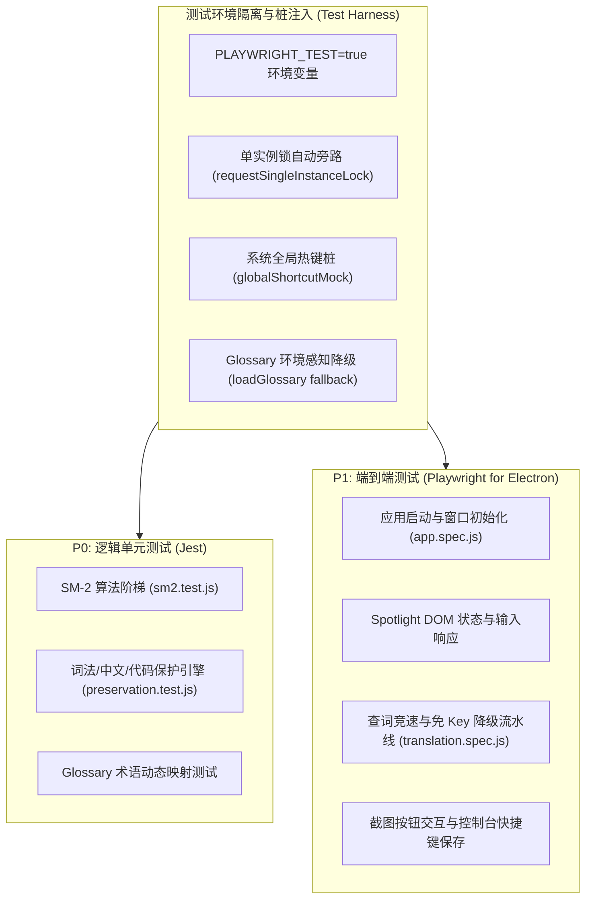

# Lumina 自动化测试架构与规范 (Automated Testing Architecture)

**版本适用**: V1.9.1+  
**测试体系**: 双轨自动化验证（Jest 纯逻辑单元测试 + Playwright for Electron 端到端 E2E 测试）

---

## 一、 战略全景：双轨防御架构

在 Lumina V1.9.0 体系中，测试防线已完成从“方案设计”到“工业化生产落地”的跃迁。针对桌面端（Electron + SQLite + 原生 OS 交互）的复杂生态，我们将测试明确划分为**算法逻辑层**与**用户流程层**两大纵深防线。



---

## 二、 单元测试工程规范 (Unit Testing - Jest)

### 1. 架构与测试靶标
- **运行引擎**: `Jest`
- **执行命令**:
  ```bash
  npm test
  ```
- **配置**: `package.json` 中的 `jest` 配置块，忽略 `node_modules` 与 `tests/e2e/` 目录。
  ```json
  "jest": {
    "testPathIgnorePatterns": [
      "/node_modules/",
      "/tests/e2e/"
    ]
  }
  ```

### 2. 测试套件构成
1. **SM-2 记忆算法测试 (`tests/sm2.test.js`)**：
   - 使用 `jest.useFakeTimers().setSystemTime()` 固化基准时间，消灭时间漂移误差。
   - 验证评分惩罚重置：用户打分 `1 (Forgot)` 强制将掌握度清零，重置复习时间为 5 分钟后。
   - 验证阶梯减退下限：打分 `2 (Hard)` 掌握度 -1，测试 Floor 边界保证不低于 0。
   - 验证阶梯递进上限：打分 `3 (Good)` 掌握度 +1，打分 `4 (Easy)` 掌握度 +2，测试 Ceiling 边界保证不超过 5。
   - 验证复习时间偏移 progression：验证 Level 3 正确映射为 1440 分钟（1天）。
2. **词法与占位符保护测试 (`tests/preservation.test.js`)**：
   - 验证单词查询直通（不污染单词查词性能）。
   - 验证反引号 inline 代码块 (`const x = 10;`) 转换为 `[__CODE_0__]` 并在翻译后原样还原。
   - 验证 HTML 标签 (`<a>link</a>`) 完整保留。
   - 验证驼峰命名 (`camelCase`) 与下划线变量 (`snake_case`) 标识符保护。
   - 验证函数调用与单行/多行注释的顺序感知保护。
   - 验证中英混杂语句中已存中文的占位与无损回填。
   - 验证 `glossary.json` 领域术语映射：如 `Auto-Pop` 自动还原为 `自动弹出`，`memory cards` 还原为 `记忆卡`。

---

## 三、 端到端测试工程规范 (E2E Testing - Playwright)

### 1. 架构与测试靶标
- **运行引擎**: `@playwright/test`
- **配置文件**: `playwright.config.js`
  ```javascript
  module.exports = {
      testDir: './tests/e2e',
      timeout: 30000,
      expect: { timeout: 10000 },
      workers: 2,
      reporter: 'list'
  };
  ```
- **执行命令**:
  ```bash
  npm run test:e2e
  ```

### 2. 测试套件构成
1. **应用基础生命周期 (`tests/e2e/app.spec.js`)**：
   - 验证 Electron 进程正常拉起，通过 `electron.launch({ executablePath, args: ['.'] })` 注入。
   - 验证至少启动 1 个可见主窗体。
   - 验证 Spotlight 核心组件存在性：`#searchInput`, `#resultArea`, `#closeBtn` 正常就绪。
2. **查词与配置流水线 (`tests/e2e/translation.spec.js`)**：
   - 验证单词查询毫秒级响应并展示 Suggest 结果。
   - 验证短语长句触发免 Key / 在线翻译引擎。
   - 验证截图翻译按钮存在且可点击。
   - 验证 Dashboard 快捷键配置持久化保存（模拟 IPC `set-screenshot-config` 并断言返回）。

### 3. 测试环境仿真与隔离保障 (Test Isolation)
为了确保 E2E 测试在 CI/CD 或开发者本地机器上不会侵入正在运行的日常实例或霸占操作系统物理热键，代码库内建了四重仿真隔离机制：
1. **单实例锁安全旁路** (`main.js`)：
   ```javascript
   if (!gotTheLock && !process.env.PLAYWRIGHT_TEST) {
       app.quit();
       return;
   }
   ```
2. **全局热键 Mock 桩** (`main.js`)：
   在检测到 `process.env.PLAYWRIGHT_TEST` 时，使用内存热键桩替换真实的 `globalShortcut.register`，避免系统级热键被占用或触发权限报警。
3. **剪贴板监听防干扰** (`src/app.js`)：
   在测试模式下自动跳过 `onClipboardData` 自动弹窗，防止剪贴板脏数据干扰断言流程。
4. **Glossary 多环境同构加载** (`utils/preservation.js`)：
   通过 `try-catch` 探测 Electron 宿主，在无宿主的 Jest 环境下自动降级为文件系统相对路径，保证测试与线上 100% 行为同构。
